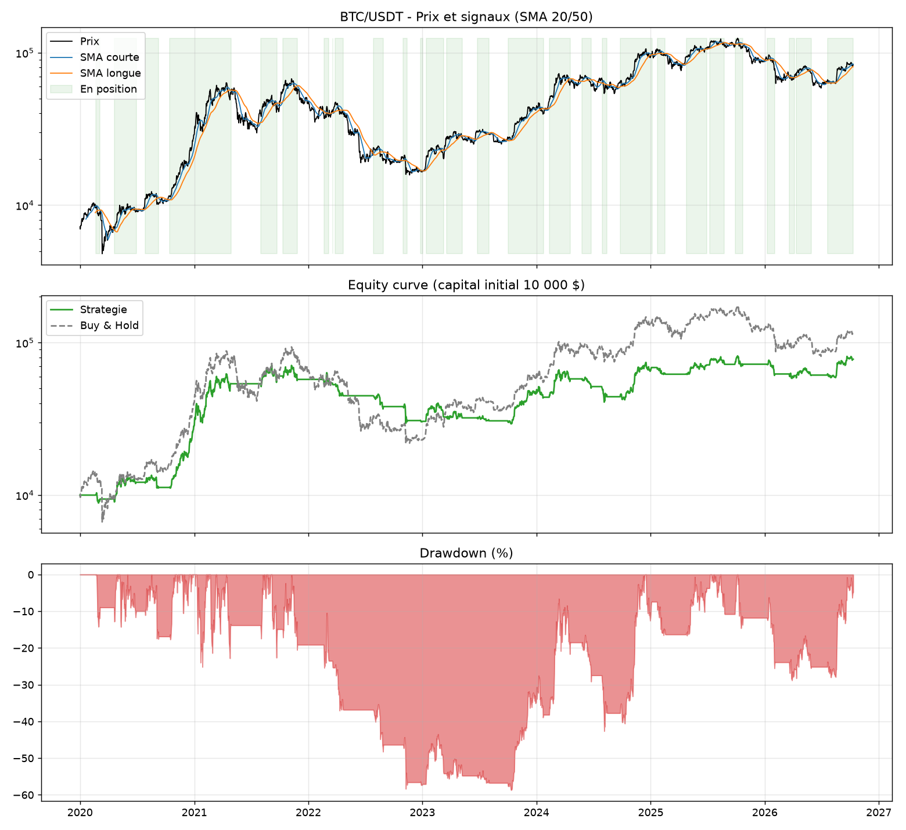

# Crypto Quant Backtester

Backtester de strategies de trading sur BTC et ETH en Python : recuperation des donnees, generation de signaux, simulation avec frais, metriques de performance et graphiques.



## Fonctionnalites

- Donnees historiques journalieres via l'API Binance (`ccxt`), du 01/01/2020 a aujourd'hui
- Strategie : croisement de moyennes mobiles (SMA 20 / SMA 50)
- Moteur de backtest **sans lookahead bias** (signal decale d'une periode) et **avec frais de trading** (0,1 % par changement de position)
- Metriques : rendement total, CAGR, Sharpe ratio, max drawdown, nombre de trades, win rate, temps en position
- Comparaison systematique avec le buy & hold
- Graphiques : prix + signaux, equity curve, drawdown

## Resultats (SMA 20/50, frais 0,1 %, capital initial 10 000 $)

| Metrique | BTC/USDT | ETH/USDT |
|---|---|---|
| Rendement strategie | 679,4 % | 1 168,8 % |
| Rendement buy & hold | 1 053,4 % | 1 813,3 % |
| CAGR | 35,4 % | 45,4 % |
| Sharpe ratio | 0,93 | 0,93 |
| Max drawdown | -58,7 % | -60,7 % |
| Nombre de trades | 28 | 24 |
| Win rate | 42,9 % | 54,2 % |
| Temps en position | 54,3 % | 52,6 % |

## Lecture des resultats

La strategie SMA 20/50 reste **en dessous du buy & hold** en rendement brut, avec un drawdown comparable. Ce resultat est volontairement conserve : un backtest honnete montre aussi les limites d'une strategie simple. Le Sharpe ratio de 0,93 est correct mais pas exceptionnel.

## Installation

```
git clone https://github.com/theojoyerclement-crypto/crypto-quant-backtester.git
cd crypto-quant-backtester
python -m venv venv
venv\Scripts\activate
pip install -r requirements.txt
python main.py
```

## Structure

```
crypto-quant-backtester/
|-- main.py
|-- requirements.txt
|-- src/
|   |-- data_loader.py
|   |-- strategy.py
|   |-- backtest.py
|   `-- plots.py
`-- results/
```

## Pistes d'amelioration

- Strategie RSI (mean-reversion)
- Optimisation des parametres avec separation train/test
- Version live avec signaux en temps reel
