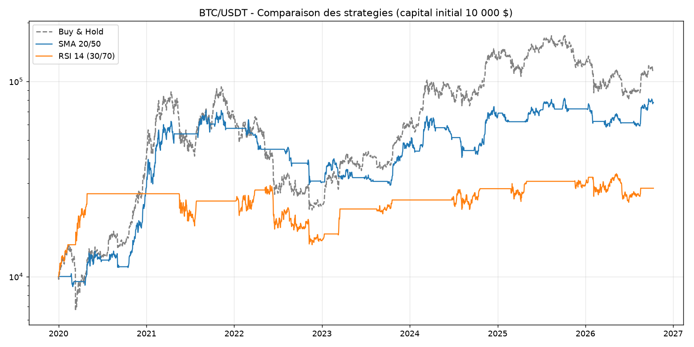

# Crypto Quant Backtester

Backtester de strategies de trading sur BTC et ETH en Python : recuperation des donnees, generation de signaux, simulation avec frais, metriques de performance et graphiques. Deux strategies sont comparees entre elles et au buy & hold, et les parametres sont valides hors echantillon.



## Fonctionnalites

- Donnees historiques journalieres via l'API Binance (`ccxt`), du 01/01/2020 a aujourd'hui
- Strategie 1 : croisement de moyennes mobiles (SMA 20 / SMA 50), suivi de tendance
- Strategie 2 : RSI 14 (achat sous 30, vente au-dessus de 70), mean-reversion
- Moteur de backtest **sans lookahead bias** (signal decale d'une periode) et **avec frais de trading** (0,1 % par changement de position)
- Metriques : rendement total, CAGR, Sharpe ratio, max drawdown, nombre de trades, win rate, temps en position
- Comparaison systematique avec le buy & hold
- Graphiques : prix + signaux, equity curve, drawdown, comparaison des strategies
- Optimisation des parametres avec separation train/test (detection de l'overfitting)

## Resultats BTC/USDT (frais 0,1 %, capital initial 10 000 $)

| Metrique | SMA 20/50 | RSI 14 (30/70) | Buy & hold |
|---|---|---|---|
| Rendement total | 679,4 % | 183,3 % | 1 053,4 % |
| CAGR | 35,4 % | 16,6 % | - |
| Sharpe ratio | 0,93 | 0,59 | - |
| Max drawdown | -58,7 % | -50,4 % | - |
| Nombre de trades | 28 | 11 | - |
| Win rate | 42,9 % | 72,7 % | - |
| Temps en position | 54,3 % | 40,4 % | 100 % |

## Resultats ETH/USDT

| Metrique | SMA 20/50 | RSI 14 (30/70) | Buy & hold |
|---|---|---|---|
| Rendement total | 1 168,8 % | 160,1 % | 1 813,3 % |
| CAGR | 45,4 % | 15,1 % | - |
| Sharpe ratio | 0,93 | 0,53 | - |
| Max drawdown | -60,7 % | -58,6 % | - |
| Nombre de trades | 24 | 9 | - |
| Win rate | 54,2 % | 66,7 % | - |
| Temps en position | 52,6 % | 35,2 % | 100 % |

## Lecture des resultats

- Aucune des deux strategies ne bat le buy & hold en rendement brut sur la periode. Ce resultat est volontairement conserve : un backtest honnete montre aussi les limites.
- La SMA domine le RSI sur BTC comme sur ETH (Sharpe 0,93 contre 0,59 et 0,53). Sur des actifs en forte tendance, suivre la tendance fonctionne mieux que parier sur un retour a la moyenne.
- Le RSI a le meilleur win rate mais le pire rendement : il gagne souvent de petits gains, rate l'essentiel des hausses (40 % du temps en position seulement) et encaisse de grosses pertes quand une chute se poursuit apres son achat. Un win rate eleve ne fait pas une bonne strategie.
- Le RSI ne genere que 9 a 11 trades sur 6 ans : l'echantillon est trop faible pour conclure de facon robuste.
- Les parametres par defaut (20/50, 14/30/70) sont des valeurs classiques, non optimisees. La section suivante teste ce qui se passe quand on les optimise.

## Validation hors echantillon (train/test)

Pour verifier que la strategie ne fait pas de l'overfitting, les parametres SMA sont optimises sur 2020-2023 (train, grille de 10 a 50 pour la SMA courte et 50 a 200 pour la longue, critere : Sharpe), puis figes et evalues sur 2024-2026 (test).

| | BTC train | BTC test | ETH train | ETH test |
|---|---|---|---|---|
| Parametres | SMA 10/100 | SMA 10/100 | SMA 10/200 | SMA 10/200 |
| Sharpe | 1,37 | 0,65 | 1,35 | 0,38 |

Sur le test, les parametres par defaut SMA 20/50 font mieux que les parametres optimises (Sharpe 0,71 contre 0,65 sur BTC, 0,72 contre 0,38 sur ETH). Conclusion : l'optimisation sur le passe a surtout ajuste du bruit. Limites : le test ne contient que 5 a 13 trades, et la periode train inclut le bull run 2020-2021, donc une partie de la degradation vient aussi du changement de regime de marche.

Script : `python src/optimize.py`

## Installation

```
git clone https://github.com/theojoyerclement-crypto/crypto-quant-backtester.git
cd crypto-quant-backtester
python -m venv venv
venv\Scripts\activate
pip install -r requirements.txt
python main.py
python src/optimize.py
```

## Structure

```
crypto-quant-backtester/
|-- main.py
|-- requirements.txt
|-- src/
|   |-- data_loader.py
|   |-- strategy.py
|   |-- backtest.py
|   |-- plots.py
|   `-- optimize.py
`-- results/
```

## Pistes d'amelioration

- Walk-forward (reoptimisation glissante) pour tester la robustesse sur plusieurs fenetres
- Version live avec signaux en temps reel